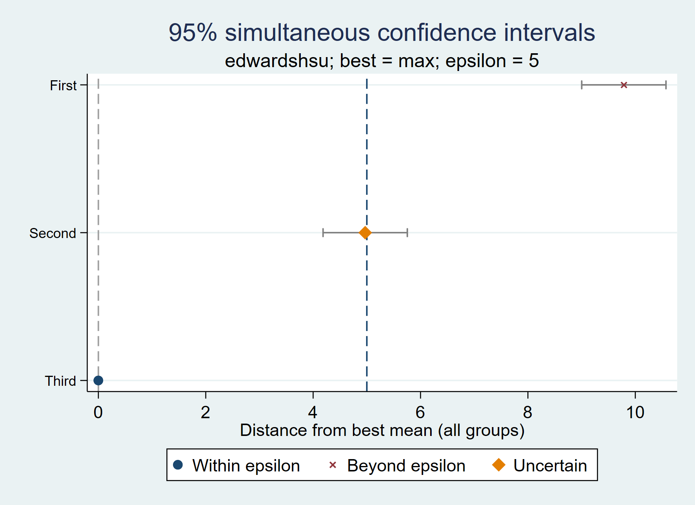

# mcb-stata: multiple comparisons with the best

Compare independent group means with the unknown best population mean. Find
which groups remain possible best groups, estimate their distance from the best,
and assess whether that distance is within a practical margin.

[한국어 안내](README_ko.md) · [Worked example](docs/quickstart.md) ·
[Methods](docs/methods.md) · [Validation](docs/validation.md)

**Suite 0.1.6 — release candidate.** Requires Stata 16.1 or later. Analysis and
examples run entirely in Stata/Mata; no R, Python or extra Stata package is needed.
Installation, reinstallation, all 57 help example commands and 14 analytic quickchecks
have passed for 0.1.6 on macOS/MP 16.1. Native Windows/MP 16.1 evidence covers
0.1.5: installation, reinstallation, 14 combined-help commands and 14 quickchecks. Other Stata versions and Linux
have not been verified. [Read the scope of this evidence](docs/validation.md).

## Install and try it

Download the [complete repository ZIP](https://github.com/renegade68/mcb-stata/archive/refs/heads/main.zip) and extract it. Save your current data and
open a fresh Stata session. Change Stata's working directory to the extracted
repository folder, then run:

```stata
cd suite
do install_mcbhsu_suite.do
help mcbhsu_suite
do first_steps.do
```

The example generates its own data, draws the graph below and finishes with
`MCBHSU_FIRST_STEPS_PASSED`. It replaces data in memory and writes files into
`suite/onboarding_example/`; repeating the example overwrites its example outputs.



For this example, **First** is beyond the margin, **Second** is uncertain, and
**Third** is within the margin. Five units is illustrative: choose a meaningful
margin for your application. [Read the intervals and decisions](docs/quickstart.md).

Alternatively, download the fixed [suite 0.1.6 ZIP](downloads/mcbhsu-suite-0.1.6-candidate.zip). If you use this archive instead of the repository ZIP,
its installer is at the top level: start with `do install_mcbhsu_suite.do`
without `cd suite`. Keep the whole extracted folder together.

## Analyze your data

After installation, change to your data directory and load your own dataset.
Replace `y` and `treatment` below with your outcome and group variables.

```stata
* Which groups remain possibly best?
mcbhsu y, over(treatment) graph

* How far below the best population mean might each group be?
mcbhsu y, over(treatment) method(edwardshsu) graph

* Immediately afterward: is the distance within five outcome units?
mcbhsumargin, epsilon(5) graph
```

Larger means are preferred by default. Add `best(min)` to the analysis command
when smaller means are preferred. A retained candidate is not evidence that
means are equal or that its distance is within your margin. The default signed
intervals include zero by construction; use their candidate flags for screening.
[See the targets, assumptions and decision rules](docs/methods.md).

| Command | Input or purpose |
| --- | --- |
| `mcbhsu` | Individual observations grouped by treatment |
| `mcbhsus` | Group counts, means and sample standard deviations, or a common MSE |
| `mcbhsumargin` | Within, beyond or uncertain relative to a specified distance margin |

Use `help mcbhsus` for summary input. From `suite/`, run
`do demo_mcbhsu_suite.do` to check raw-data/summary-data agreement and saved-result
margin decisions.

## Reproduce the published example

After installing the suite, run the companion in
[examples/published-filters](examples/published-filters/README.txt).
It contains the observations, a Stata do-file, expected CSVs and two graphs for
the Edwards–Hsu filter example. No article PDF or data download is required. The [companion ZIP](downloads/mcbhsu-paper-example-suite-0.1.6.zip) includes the revised citations.
The companion was executed on macOS/MP 16.1; its separate Windows run is not
part of the installation evidence above.

## Check an installation

Save your work, open a fresh Stata session and change to `suite/`:

```stata
do validate_installation.do "my_installation_check"
```

The output directory must be new. Completion is indicated by
`MCBHSU_INSTALLATION_CHECK_PASSED` and `my_installation_check/results/status.txt`.
Use a different directory name for another run.
[Check instructions and troubleshooting](docs/troubleshooting.md).

## Scope, versions and citation

The repository can host additional MCB methods as they are developed and validated.
The current release provides the independent-group commands documented here;
DEA and panel/frontier extensions are not included.

The model requires independent normal observations with a common unknown
variance and positive residual variation. It supports 2–50 groups, unequal group
sizes, numeric/string group keys and confidence levels 80–99.9. Covariate-adjusted
means, unequal variances, clustered/repeated measurements and panel/frontier
models require other methods. Some numerical integrations can take time.

This candidate includes core 0.9.2, summary 0.1.1 and margin 0.1.1. Recompute
results saved with an older engine before applying the current margin command.
Suite 0.1.6 is a documentation revision with unchanged statistical components.
Its installation and examples passed on macOS; native Windows evidence covers
suite 0.1.5. See [version-specific validation](docs/validation.md). Candidate status does not imply SSC availability
or journal acceptance.

[Release notes](RELEASE_NOTES.md) · [Software citation](CITATION.cff) ·
[Academic Free License 3.0](LICENSE)

Copyright 2026 Choonjoo Lee.

## References

[Complete bibliography and what to cite](docs/methods.md#references-and-attribution) · [BibTeX](docs/references.bib).
Edwards and Hsu (1983) and their 1984 JASA corrigendum are the paired sources
for the distance construction. Hsu (1984, Annals of Statistics) is a separate
constrained-MCB paper. `CITATION.cff` cites this software and lists the sources.
