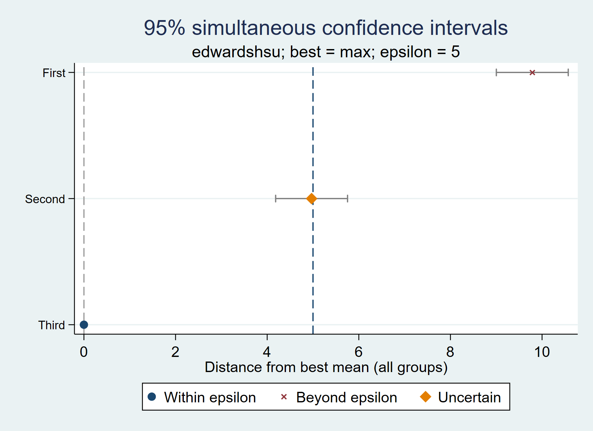

# mcb-stata: Stata에서 최우수 집단과 다중비교하기

독립된 집단의 평균을 비교하여 **최우수일 가능성이 남은 집단**, **최우수 평균과의 거리**,
**그 거리가 실질적으로 허용할 범위인지**를 살펴봅니다.

[English](README.md) · [예제 해석](docs/quickstart.md) ·
[방법과 가정](docs/methods.md) · [검증 기록](docs/validation.md)

**Suite 0.1.5 — 배포 후보판.** Stata 16.1 이상이 필요합니다. 분석과 예제는 Stata/Mata만으로
실행되며 R·Python·추가 Stata 패키지가 필요하지 않습니다. macOS와 Windows의 Stata/MP 16.1에서
설치·재설치, 설치된 도움말 예제, 수치 점검 14건이 통과했습니다.
Linux와 다른 Stata 버전은 아직 검증하지 않았습니다.

## 설치하고 예제 실행하기

[저장소 ZIP](https://github.com/renegade68/mcb-stata/archive/refs/heads/main.zip)을 모두 풀고, 현재 자료를 저장한 뒤 새 Stata 세션을 여세요.
Stata의 작업 폴더를 압축 해제한 저장소 폴더로 바꾼 뒤 실행합니다.

```stata
cd suite
do install_mcbhsu_suite.do
help mcbhsu_suite
do first_steps.do
```

예제는 자료를 직접 생성하고 아래 그래프를 그립니다. 완료 표식은
`MCBHSU_FIRST_STEPS_PASSED`입니다. 메모리 자료가 교체되며 결과는
`suite/onboarding_example/`에 저장됩니다. 예제를 반복하면 해당 예제 출력은 덮어씁니다.



이 예제에서 First는 허용거리 밖, Second는 판단 유보, Third는 허용거리 안입니다.
5는 설명용 값이며 실제 분석에서는 자료의 단위와 연구 목적에 맞게 정하세요.

저장소 ZIP 대신 [검증된 suite 0.1.5 ZIP](downloads/mcbhsu-suite-0.1.5-candidate.zip)을 받았다면 설치 파일이 최상위에 있습니다.
이때는 `cd suite` 없이 `do install_mcbhsu_suite.do`부터 실행하세요.
압축 해제한 파일들은 함께 보관합니다.

## 본인의 자료 분석하기

설치 후에는 자료 폴더로 이동해 본인의 데이터를 불러오세요.
`y`와 `treatment`는 본인의 결과 변수와 집단 변수 이름으로 바꿉니다.

```stata
* 최우수일 가능성이 남은 집단
mcbhsu y, over(treatment) graph

* 전체 최우수 평균과의 거리
mcbhsu y, over(treatment) method(edwardshsu) graph

* 바로 이어서, 그 거리가 5 이내인지 판정
mcbhsumargin, epsilon(5) graph
```

기본값은 큰 평균을 선호합니다. 작은 값이 좋으면 분석 명령에 `best(min)`을 추가하세요.
후보로 남았다는 사실은 평균이 같거나 허용거리 안에 있다는 증거가 아닙니다.
기본 constrained 방법의 구간은 구성상 0을 포함하므로 후보 플래그를 사용합니다.

| 명령 | 용도 |
| --- | --- |
| `mcbhsu` | 개별 관측값을 집단별로 분석 |
| `mcbhsus` | 집단별 표본 수·평균·표본표준편차 또는 공통 MSE로 분석 |
| `mcbhsumargin` | 거리의 허용범위 안·밖·판단 유보 분류 |

요약자료 입력은 `help mcbhsus`를 참고하세요. `suite/`에서
`do demo_mcbhsu_suite.do`를 실행하면 원자료·요약자료 일치와 저장 결과의 판정을 확인합니다.

## 논문 예제 재현하기

설치 후 [examples/published-filters의 한국어 안내](examples/published-filters/README_ko.txt)를
따라 실행하세요. 필터 관측값, Stata do-file, 비교용 CSV와 그래프가 들어 있습니다.
논문 PDF나 외부 자료 다운로드는 필요하지 않습니다. 이 별도 예제는 macOS에서 검증했고,
Windows 설치 검증과는 구분합니다.

## 설치 상태 확인하기

자료를 저장하고 새 Stata 세션에서 `suite/` 폴더로 이동한 뒤 실행하세요.

```stata
do validate_installation.do "my_installation_check"
```

완료 표식은 `MCBHSU_INSTALLATION_CHECK_PASSED`이며
`my_installation_check/results/status.txt`에도 기록됩니다.
결과 폴더가 이미 있으면 기존 결과를 보호하기 위해 중단합니다. 재실행할 때는 새 이름을 쓰세요.
[실행 점검과 오류 안내](docs/troubleshooting.md)를 참고하세요.

## 적용 범위와 배포 상태

저장소는 향후 검증된 다른 MCB 방법도 수용할 수 있도록 구성합니다. 현재 제공하는
명령은 아래 독립집단 분석이며 DEA·패널·프런티어 확장 명령은 포함하지 않습니다.

독립 정규 관측값, 공통 분산, 양의 잔차 변동을 가정합니다. 2–50개 집단과 불균형 표본을
지원합니다. 공변량 조정, 이분산, 군집·반복측정, 패널·프런티어 모형은 이 명령의 범위 밖입니다.

core 0.9.2, summary 0.1.1, margin 0.1.1을 함께 사용하세요. 이전 엔진으로 저장한 결과는
현재 margin 명령을 사용하기 전에 다시 계산합니다.
`suite/`는 검증받은 0.1.5 파일 그대로입니다. 안에 들어 있는 검증 안내는 Windows 결과 수신 전
작성본이며, [현재 검증 기록](docs/validation.md)에 완료 상태를 반영했습니다.
후보판 표시는 유지하며 SSC 등록이나 학술지 게재를 의미하지 않습니다.

[변경 안내](RELEASE_NOTES.md) · [인용 정보](CITATION.cff) · [AFL-3.0 라이선스](LICENSE)

Copyright 2026 Choonjoo Lee.
